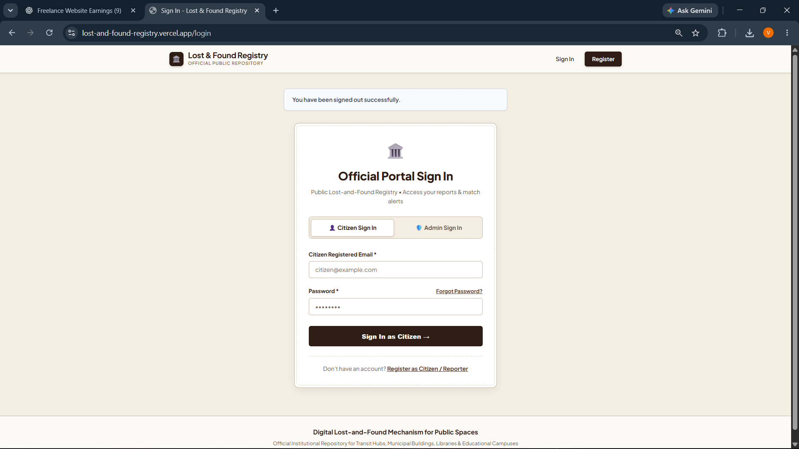
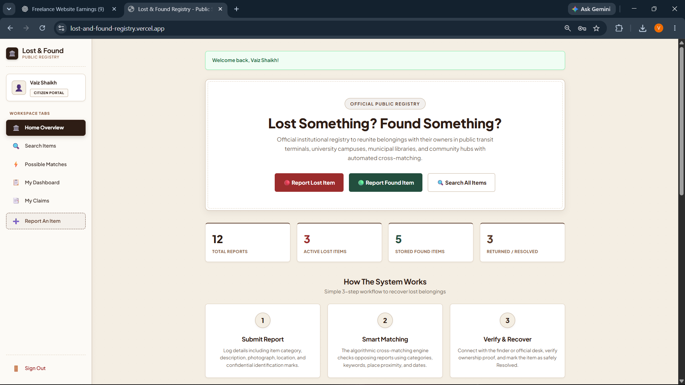
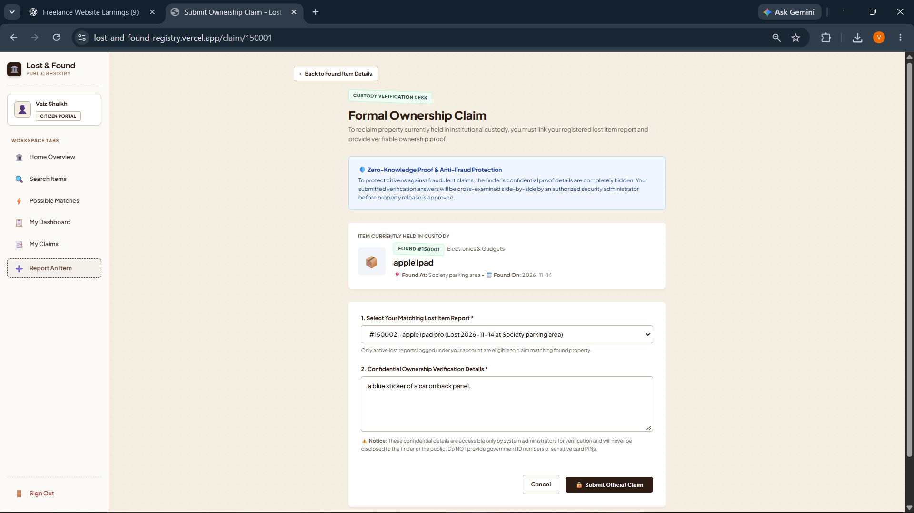
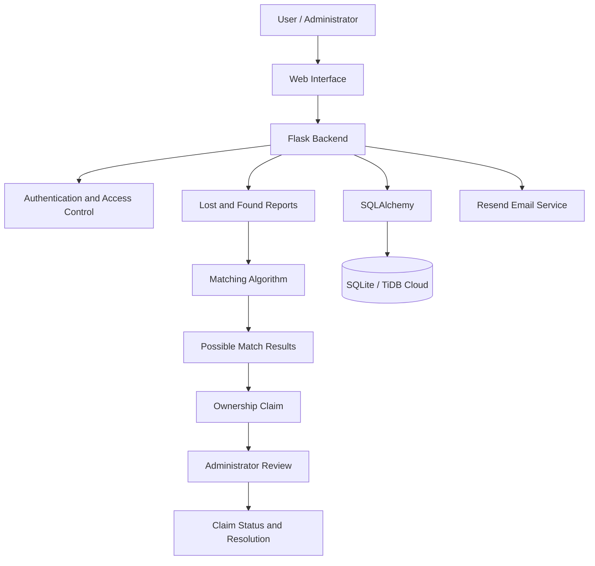

# 🔎 Digital Lost-and-Found Registry

A Flask-based web application that helps users report lost and found belongings, discover possible matches, and verify ownership through a structured claim process.

<p align="center">


</p>

<p align="center">

[🌐 Live Application](https://lost-and-found-registry.vercel.app/) · [📂 GitHub Repository](https://github.com/ShaikhVaiz/lost-and-found-registry)

</p>

---

## 📑 Table of Contents

- [Overview](#-overview)
- [Problem Statement](#-problem-statement)
- [Key Features](#-key-features)
- [Application Screenshots](#-application-screenshots)
- [Technology Stack](#-technology-stack)
- [System Architecture](#-system-architecture)
- [Application Workflow](#-application-workflow)
- [Matching Algorithm](#-matching-algorithm)
- [Ownership Claim Process](#-ownership-claim-process)
- [Project Structure](#-project-structure)
- [Installation and Setup](#-installation-and-setup)
- [Environment Configuration](#-environment-configuration)
- [Database Configuration](#-database-configuration)
- [Running the Application](#-running-the-application)
- [Automated Testing](#-automated-testing)
- [Deployment](#-deployment)
- [Security Considerations](#-security-considerations)
- [Future Improvements](#-future-improvements)
- [Author](#-author)

---

## 📌 Overview

The **Digital Lost-and-Found Registry** provides a centralized digital platform for reporting and recovering lost belongings.

Instead of depending on manual registers or disconnected communication, users can submit lost and found reports, discover possible matches, and submit ownership claims.

The system includes an administrative dashboard where authorized administrators can review claims, manage reports, and record claim decisions.

The project focuses on making item recovery more organized while protecting confidential ownership information.

## 🎯 Problem Statement

Traditional lost-and-found processes often depend on manual registers, verbal communication, or separate records.

This can make it difficult to:

- Search through previously reported items.
- Identify possible matches between lost and found belongings.
- Verify whether a claimant is the rightful owner.
- Track the status of an ownership claim.
- Maintain a clear record of administrative decisions.

This application provides a structured digital process to address these challenges.

## ✨ Key Features

| Feature | Description |
|---|---|
| User Authentication | Registration, login, logout, and password recovery |
| Lost Item Reporting | Submit information about missing belongings |
| Found Item Reporting | Register belongings that have been found |
| Possible Match Detection | Compare reports using multiple matching criteria |
| Ownership Verification | Submit private information to support an ownership claim |
| Claim Management | Track pending, approved, and rejected claims |
| Admin Dashboard | Review claims and manage item reports |
| Claim Audit History | Maintain records of important claim-related actions |
| Email OTP | Email-based password recovery using Resend |
| Search and Filtering | Search reports using keywords, categories, locations, and status |
| Image Uploads | Attach images to item reports |

## 📸 Application Screenshots

### 1. Login Page



### 2. User Dashboard



### 3. Report an Item


### 4. Possible Matches


### 5. Ownership Claim Verification



### 6. Admin Dashboard


---

## 🛠️ Technology Stack

| Component | Technology |
|---|---|
| Programming Language | Python |
| Backend Framework | Flask |
| Frontend | HTML5, CSS3, JavaScript |
| Database ORM | SQLAlchemy, Flask-SQLAlchemy |
| Local Database | SQLite |
| Production Database | TiDB Cloud (MySQL-compatible) |
| Authentication | Werkzeug Password Hashing |
| CSRF Protection | Flask-WTF |
| Email OTP | Resend API |
| Database Driver | PyMySQL |
| Production Server | Gunicorn |
| Deployment | Vercel |

## 🏗️ System Architecture



## ⚙️ Application Workflow

1. A user registers and logs in.
2. The user submits a lost or found item report.
3. The application compares reports and identifies possible matches.
4. Users review relevant match suggestions.
5. A claimant submits private ownership information.
6. An administrator reviews the submitted claim.
7. The administrator approves or rejects the claim.
8. The application updates the related claim and report status.
9. Important claim actions are recorded in the audit history.

## 🔍 Matching Algorithm

The application uses a multi-factor matching algorithm to compare lost and found reports.

Each report comparison can receive a score out of 100 points.

| Matching Factor | Maximum Points |
|---|---:|
| Category Match | 35 |
| Title and Description Keyword Overlap | 35 |
| Location Similarity | 20 |
| Date Proximity | 10 |
| **Total** | **100** |

### How the Matching Works

- **Category:** Checks whether both reports belong to the same item category.
- **Keywords:** Compares words from item titles, descriptions, and identifying details.
- **Location:** Checks for overlapping location keywords.
- **Date:** Gives a higher score when the reported dates are closer.

Possible matches are ranked by their calculated scores.

The application uses different minimum score thresholds for different match views.

## 🔐 Ownership Claim Process

A matching description alone does not establish ownership.

The application includes a structured claim process:

1. The claimant selects their own lost-item report.
2. The claimant submits private ownership verification details.
3. The claim is saved with a pending status.
4. An administrator reviews the claim.
5. The administrator approves or rejects it.
6. The decision and related actions are recorded in the claim audit history.

Database constraints also help prevent multiple approved claims for the same found-item report.

## 📁 Project Structure

```text
lost-and-found-registry/
│
├── api/
│
├── docs/
│   └── screenshots/
│       ├── login.png
│       ├── dashboard.png
│       ├── report-form.png
│       ├── matches.png
│       ├── claim-page.png
│       └── admin-dashboard.png
│
├── public/
├── static/
├── templates/
│
├── app.py
├── requirements.txt
├── test_app.py
├── Procfile
├── vercel.json
├── .gitignore
└── README.md
```

## 🚀 Installation and Setup

### Prerequisites

- Python
- Git
- TiDB Cloud account for production database configuration
- Resend API key for email OTP functionality

### 1. Clone the Repository

```bash
git clone https://github.com/ShaikhVaiz/lost-and-found-registry.git
cd lost-and-found-registry
```

### 2. Create a Virtual Environment

```bash
python -m venv .venv
```

### 3. Activate the Virtual Environment

**Windows PowerShell:**

```powershell
.\.venv\Scripts\Activate.ps1
```

**Linux / macOS:**

```bash
source .venv/bin/activate
```

### 4. Install Dependencies

```bash
pip install -r requirements.txt
```

## 🔐 Environment Configuration

Create a private `.env` file in the project root directory.

Configure the required application settings:

```env
SECRET_KEY=your_secure_secret_key
ADMIN_ID=your_admin_id
ADMIN_PASSWORD=your_admin_password
```

For email OTP functionality:

```env
RESEND_API_KEY=your_resend_api_key
```

### TiDB Cloud Configuration

For production database connectivity, configure the TiDB Cloud connection settings:

```env
TIDB_HOST=your_tidb_host
TIDB_PORT=4000
TIDB_USER=your_tidb_username
TIDB_PASSWORD=your_tidb_password
TIDB_DATABASE=lost_found
```

Alternatively, the application supports a database connection URL through `TIDB_URL` or `DATABASE_URL`.

**Important:** Never commit your actual `.env` file, administrator password, API keys, or database credentials to GitHub.

## 🗄️ Database Configuration

The application supports:

- **SQLite:** Local development database.
- **TiDB Cloud:** Persistent cloud database for production.

The production configuration requires a persistent remote database. The application explicitly prevents production deployment from silently using temporary SQLite storage.

## ▶️ Running the Application

Start the application:

```bash
python app.py
```

Open your browser:

```text
http://127.0.0.1:5000
```

## 🧪 Automated Testing

The project includes an automated test suite.

Run the tests using:

```bash
python -m unittest test_app.py
```

## ☁️ Deployment

The application is deployed using Vercel.

**Live Application:**

https://lost-and-found-registry.vercel.app/

Production deployment requires the appropriate environment variables, administrator credentials, Resend configuration, and persistent cloud database connection.

## 🔒 Security Considerations

- Passwords are stored using secure password hashing.
- CSRF protection is implemented using Flask-WTF.
- Administrative functions require restricted access.
- Secret keys and credentials are configured through environment variables.
- Ownership-verification details are treated as confidential.
- Database constraints help protect claim integrity.
- Claim-related administrative actions are recorded in an audit history.
- Production deployments require a persistent remote database.

## 🚀 Future Improvements

- Improve matching accuracy and relevance.
- Add more detailed item search and filtering.
- Improve claim status notifications.
- Expand administrative reporting.
- Add further automated integration tests.
- Improve accessibility and mobile responsiveness.

## 👨‍💻 Author

**Shaikh Vaiz**

- GitHub: [@ShaikhVaiz](https://github.com/ShaikhVaiz)
- Repository: [Digital Lost-and-Found Registry](https://github.com/ShaikhVaiz/lost-and-found-registry)

---

<p align="center">

**Built with Python, Flask, SQLAlchemy, and TiDB Cloud.**

</p>
