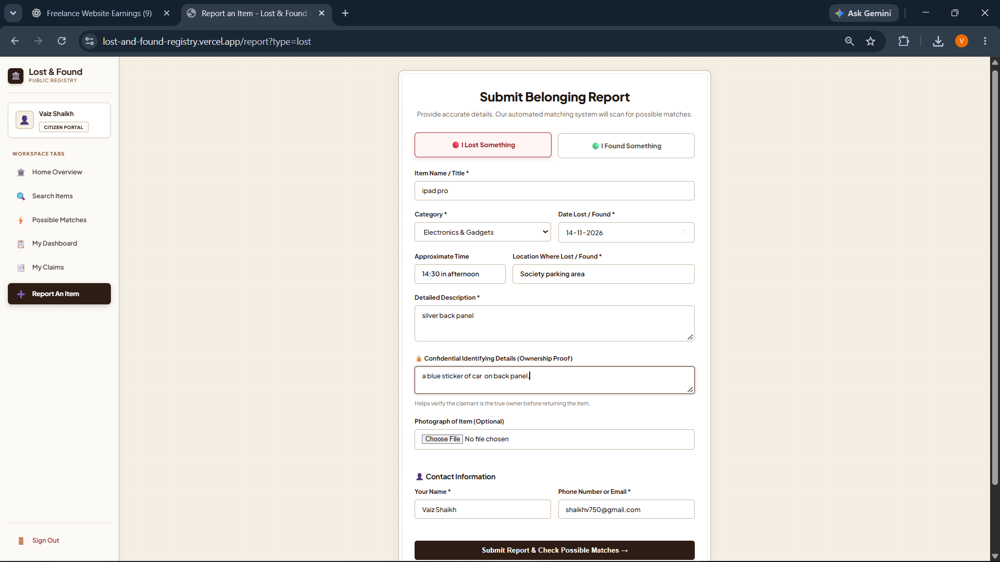
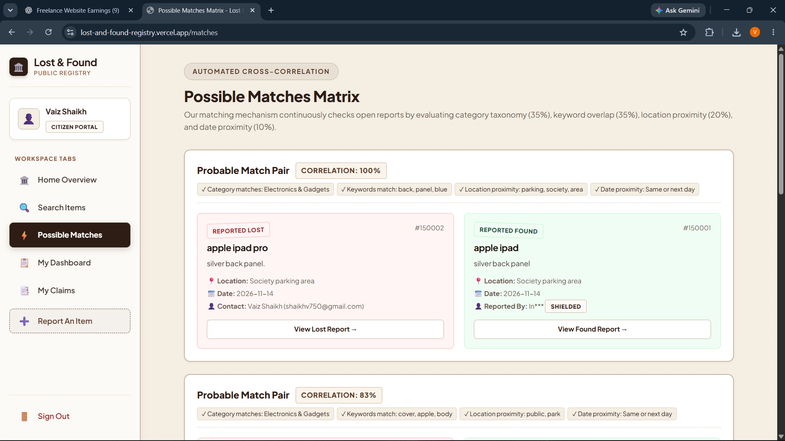
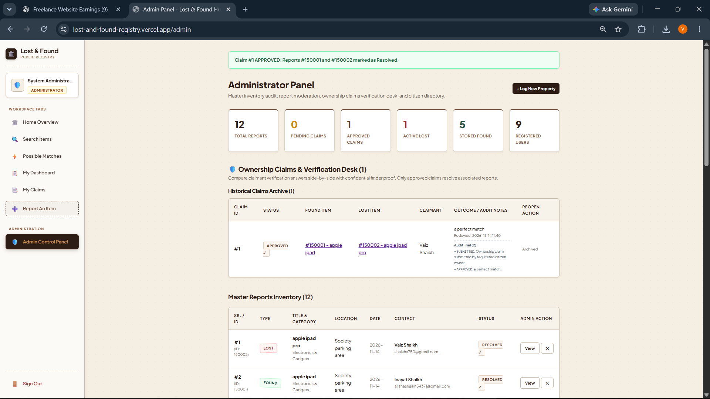
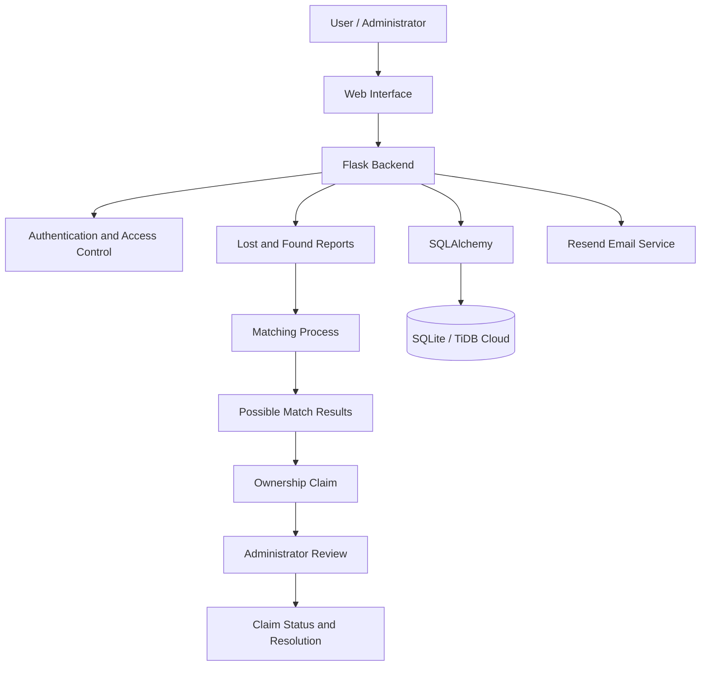
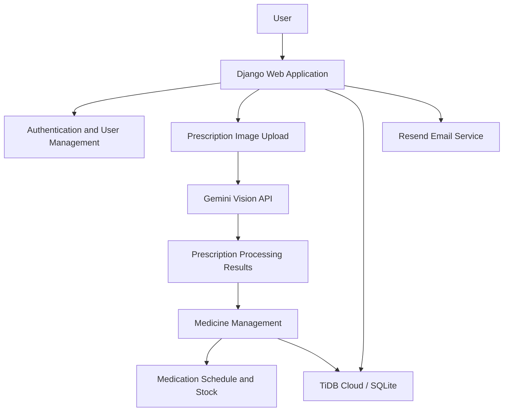

# 🔎 Digital Lost-and-Found Registry

A Flask-based web application that helps users report lost and found belongings, discover possible matches, and verify ownership through a structured claim process.

\<p align="center">   \   \   \   \   \ \</p>

\<p align="center">   \<a href="[https://lost-and-found-registry.vercel.app/](https://lost-and-found-registry.vercel.app/)">\<strong>🌐 Live Application\</strong>\</a> ·   \<a href="[https://github.com/ShaikhVaiz/lost-and-found-registry](https://github.com/ShaikhVaiz/lost-and-found-registry)">\<strong>📂 GitHub Repository\</strong>\</a> \</p>

---

## 📑 Table of Contents

- [Overview](#-overview)
- [Problem Statement](#-problem-statement)
- [Key Features](#-key-features)
- [Application Screenshots](#-application-screenshots)
- [Technology Stack](#-technology-stack)
- [System Architecture](#-system-architecture)
- [Application Workflow](#-application-workflow)
- [Matching and Claim Process](#-matching-and-claim-process)
- [Project Structure](#-project-structure)
- [Installation and Setup](#-installation-and-setup)
- [Environment Configuration](#-environment-configuration)
- [Running the Application](#-running-the-application)
- [Automated Testing](#-automated-testing)
- [Deployment](#-deployment)
- [Security Considerations](#-security-considerations)
- [Future Improvements](#-future-improvements)
- [Author](#-author)

---

## 📌 Overview

The **Digital Lost-and-Found Registry** provides a centralized platform for reporting and recovering lost belongings.

Instead of depending on manual registers or disconnected communication, users can submit lost and found reports, discover possible matches, and submit claims to verify ownership.

Administrators can review claims, manage reports, and handle claim decisions through an administrative dashboard.

The project focuses on making item recovery more organized while protecting confidential ownership information.

## 🎯 Problem Statement

Traditional lost-and-found processes often depend on manual registers, verbal communication, or separate records.

This can make it difficult to:

- Search through previously reported items.
- Identify possible matches between lost and found belongings.
- Verify whether a claimant is the rightful owner.
- Track the status of an ownership claim.
- Maintain a clear record of administrative decisions.

This application provides a structured digital process to address these challenges.

## ✨ Key Features

| Feature                  | Description                                                             |
| ------------------------ | ----------------------------------------------------------------------- |
| User Authentication      | Registration, login, logout, and password recovery                      |
| Lost Item Reporting      | Submit information about missing belongings                             |
| Found Item Reporting     | Register belongings that have been found                                |
| Possible Match Detection | Compare lost and found reports using matching criteria                  |
| Ownership Verification   | Submit confidential information to support an ownership claim           |
| Claim Management         | Track pending, approved, and rejected claims                            |
| Admin Dashboard          | Review claims and manage item reports                                   |
| Claim Audit History      | Maintain records of important claim-related actions                     |
| Privacy Protection       | Password hashing, CSRF protection, and restricted administrative access |
| Email OTP                | Email-based verification using Resend                                   |

## 📸 Application Screenshots

### 1. Login Page

\<p align="center">
&#x20; \
\</p>

### 2. User Dashboard

\<p align="center">
&#x20; \
\</p>

### 3. Report an Item

\<p align="center">
&#x20; \
\</p>

### 4. Possible Matches

\<p align="center">
&#x20; \
\</p>

### 5. Claim Verification

\<p align="center">
&#x20; \
\</p>

### 6. Admin Dashboard

\<p align="center">
&#x20; \
\</p>

## 🛠️ Technology Stack

| Component           | Technology                    |
| ------------------- | ----------------------------- |
| Backend             | Python, Flask                 |
| Frontend            | HTML5, CSS3, JavaScript       |
| Database ORM        | SQLAlchemy, Flask-SQLAlchemy  |
| Local Database      | SQLite                        |
| Production Database | TiDB Cloud (MySQL-compatible) |
| Authentication      | Werkzeug Password Hashing     |
| CSRF Protection     | Flask-WTF                     |
| Email OTP           | Resend API                    |
| Production Server   | Gunicorn                      |
| Deployment          | Vercel                        |

## 🏗️ System Architecture



## ⚙️ Application Workflow

1. A user registers and logs in.
2. The user submits a lost or found item report.
3. The application compares reports and identifies possible matches.
4. Users can review relevant match suggestions.
5. A claimant submits ownership information for verification.
6. An administrator reviews the submitted claim.
7. The administrator approves or rejects the claim.
8. The application updates the related claim and report status.

## 🔍 Matching and Claim Process

The application compares lost and found reports using matching criteria to identify potentially related items.

The claim process provides an additional ownership-verification step instead of allowing an item to be claimed solely because its description appears similar.

Administrators review submitted claims before making a decision.

## 📁 Project Structure

```text
lost-and-found-registry/
│
├── api/
├── docs/
│   └── screenshots/
│       ├── login.png
│       ├── dashboard.png
│       ├── report-form.png
│       ├── matches.png
│       ├── claim-page.png
│       └── admin-dashboard.png
│
├── public/
├── static/
├── templates/
│
├── app.py
├── requirements.txt
├── test_app.py
├── Procfile
├── vercel.json
├── .gitignore
└── README.md
```

## 🚀 Installation and Setup

### Prerequisites

- Python
- Git
- A supported local SQLite or production TiDB Cloud database configuration
- Resend API key if email OTP functionality is required

### 1. Clone the Repository

```bash
git clone https://github.com/ShaikhVaiz/lost-and-found-registry.git
cd lost-and-found-registry
```

### 2. Create a Virtual Environment

```bash
python -m venv .venv
```

### 3. Activate the Virtual Environment

**Windows PowerShell:**

```powershell
.\.venv\Scripts\Activate.ps1
```

**Linux / macOS:**

```bash
source .venv/bin/activate
```

### 4. Install Dependencies

```bash
pip install -r requirements.txt
```

### 5. Configure Environment Variables

Create a private `.env` file in the project root.

Configure the required application settings:

```env
SECRET_KEY=your_secure_secret_key
ADMIN_ID=your_admin_id
ADMIN_PASSWORD=your_admin_password
```

For email OTP functionality, configure:

```env
RESEND_API_KEY=your_resend_api_key
```

For production database usage, configure the TiDB Cloud connection settings required by the application.

**Important:** Never commit your actual `.env` file, administrator password, API keys, or database credentials.

### 6. Run the Application

```bash
python app.py
```

Open your browser:

```text
http://127.0.0.1:5000
```

## 🧪 Automated Testing

The project includes an automated test suite.

Run the tests using:

```bash
python -m unittest test_app.py
```

The existing project test suite covers application functionality and important application workflows.

## ☁️ Deployment

The application is deployed using Vercel.

**Live Application:**
[https://lost-and-found-registry.vercel.app/](https://lost-and-found-registry.vercel.app/)

Production configuration uses environment variables for application security, administrator credentials, email integration, and database connectivity.

For production use, configure a persistent cloud database rather than relying on temporary local storage.

## 🔒 Security Considerations

- Passwords are stored using secure password hashing.
- CSRF protection is implemented using Flask-WTF.
- Administrative functions require restricted access.
- Secret keys and credentials should be configured through environment variables.
- Ownership-verification details should be treated as confidential.
- Production database backups should be maintained.

## 🚀 Future Improvements

- Improve matching accuracy and relevance.
- Add more detailed item search and filtering.
- Improve claim status notifications.
- Expand administrative reporting.
- Add further automated integration tests.
- Improve accessibility and mobile responsiveness.

## 👨‍💻 Author

**Shaikh Vaiz**

- GitHub: [@ShaikhVaiz](https://github.com/ShaikhVaiz)
- Repository: [Digital Lost-and-Found Registry](https://github.com/ShaikhVaiz/lost-and-found-registry)

---

\<p align="center">
&#x20; \<strong>Built with Python, Flask, SQLAlchemy, and TiDB Cloud.\</strong>
\</p>\</WritingBlock}

## 3. MediSmart AI

Repository: `medismart-ai`

\<WritingBlock id="73103" variant="document"># 💊 MediSmart AI

An AI-powered medicine management platform designed to help users organize prescriptions, manage medicines, track stock, and maintain medication schedules.

\<p align="center">   \   \   \   \   \ \</p>

\<p align="center">   \<a href="[https://medismart-ai-omega.vercel.app/](https://medismart-ai-omega.vercel.app/)">\<strong>🌐 Live Application\</strong>\</a> ·   \<a href="[https://github.com/ShaikhVaiz/medismart-ai](https://github.com/ShaikhVaiz/medismart-ai)">\<strong>📂 GitHub Repository\</strong>\</a> \</p>

---

## 📑 Table of Contents

- [Overview](#-overview)
- [Problem Statement](#-problem-statement)
- [Key Features](#-key-features)
- [Application Screenshots](#-application-screenshots)
- [Technology Stack](#-technology-stack)
- [System Architecture](#-system-architecture)
- [Application Workflow](#-application-workflow)
- [Project Structure](#-project-structure)
- [Installation and Setup](#-installation-and-setup)
- [Environment Configuration](#-environment-configuration)
- [Database Configuration](#-database-configuration)
- [Running the Application](#-running-the-application)
- [Deployment](#-deployment)
- [Security Considerations](#-security-considerations)
- [Medical Disclaimer](#-medical-disclaimer)
- [Future Improvements](#-future-improvements)
- [Author](#-author)

---

## 📌 Overview

**MediSmart AI** is a web-based medicine management platform that brings prescription organization and medication tracking into one place.

The application uses Django for backend development and Gemini Vision for AI-assisted prescription image processing.

It also integrates TiDB Cloud for database storage and Resend for email-based OTP verification.

The goal is to make medicine information easier to organize and manage through a centralized interface.

## 🎯 Problem Statement

Managing prescriptions and medicine schedules can become difficult when information is stored across paper documents or separate records.

Users may need a convenient way to:

- Organize prescription information.
- Manage medicine details.
- Track available medicine quantities.
- Maintain medication schedules.
- Manage medicine information for family members.
- Handle medicine refill information.

MediSmart AI aims to provide a centralized digital platform for these tasks.

## ✨ Key Features

| Feature                  | Description                                                 |
| ------------------------ | ----------------------------------------------------------- |
| AI Prescription Scanning | Uses Gemini Vision to process prescription images           |
| Medicine Management      | Organizes and manages medicine information                  |
| Medicine Reminders       | Provides browser-based reminders for medication schedules   |
| Stock Tracking           | Tracks available medicine quantities                        |
| Family Profiles          | Supports medicine information management for family members |
| Refill Management        | Helps manage medicine refill requests                       |
| Email OTP Verification   | Provides email-based verification using Resend              |
| Cloud Database           | Uses TiDB Cloud for application data storage                |

## 📸 Application Screenshots

### 1. Login Page

\<p align="center">
&#x20; \
\</p>

### 2. Dashboard

\<p align="center">
&#x20; \
\</p>

### 3. AI Prescription Scanner

\<p align="center">
&#x20; \
\</p>

### 4. Medicine Management

\<p align="center">   \ \</p>

### 5. Family Profiles

\<p align="center">   \ \</p>

## 🛠️ Technology Stack

| Component                  | Technology            |
| -------------------------- | --------------------- |
| Programming Language       | Python                |
| Backend Framework          | Django                |
| Frontend                   | HTML, CSS, JavaScript |
| AI Integration             | Google Gemini Vision  |
| Database                   | TiDB Cloud            |
| Local Development Database | SQLite                |
| Email Service              | Resend                |
| Image Processing           | Pillow                |
| Static File Handling       | WhiteNoise            |
| Deployment                 | Vercel                |

## 🏗️ System Architecture



## ⚙️ Application Workflow

1. The user accesses the MediSmart AI application.
2. The user signs in or completes the required email verification.
3. The user can manage medicine information through the dashboard.
4. Prescription images can be submitted for AI-assisted processing.
5. Gemini Vision processes the prescription image.
6. The application supports medicine organization and schedule management.
7. Application data is stored using the configured database.

## 📁 Project Structure

```text
medismart-ai/
│
├── docs/
│   └── screenshots/
│       ├── login.png
│       ├── dashboard.png
│       ├── prescription-scanner.png
│       ├── medicine-management.png
│       └── family-profiles.png
│
├── medismart/
├── tracker/
├── templates/
├── static/
├── staticfiles/
│
├── .env.example
├── .gitignore
├── manage.py
├── requirements.txt
├── build_files.sh
├── vercel.json
└── README.md
```

## 🚀 Installation and Setup

### Prerequisites

- Python
- Git
- Google Gemini API key
- Resend API key
- TiDB Cloud account for cloud database configuration

### 1. Clone the Repository

```bash
git clone https://github.com/ShaikhVaiz/medismart-ai.git
cd medismart-ai
```

### 2. Create a Virtual Environment

```bash
python -m venv venv
```

### 3. Activate the Virtual Environment

**Windows PowerShell:**

```powershell
.\venv\Scripts\Activate.ps1
```

**Linux / macOS:**

```bash
source venv/bin/activate
```

### 4. Install Dependencies

```bash
pip install -r requirements.txt
```

## 🔐 Environment Configuration

The repository includes an `.env.example` file containing the environment configuration template.

Create your local `.env` file:

**Windows PowerShell:**

```powershell
Copy-Item .env.example .env
```

Update the values in `.env` according to your configuration.

### Django Configuration

```env
DEBUG=True
SECRET_KEY=your_secure_secret_key
ALLOWED_HOSTS=127.0.0.1,localhost
```

### Resend Email Configuration

```env
RESEND_API_KEY=your_resend_api_key
RESEND_FROM_EMAIL=your_verified_sender_email
```

### TiDB Cloud Configuration

```env
USE_TIDB=False
TIDB_HOST=your_tidb_host
TIDB_PORT=4000
TIDB_USER=your_tidb_username
TIDB_PASSWORD=your_tidb_password
TIDB_DB_NAME=your_database_name
```

### Gemini Vision Configuration

```env
GEMINI_API_KEY=your_gemini_api_key
```

**Important:** These are example values. Never commit real API keys, database passwords, or your private `.env` file to GitHub.

## 🗄️ Database Configuration

MediSmart AI supports local SQLite development and TiDB Cloud database configuration.

| Setting          | Purpose                              |
| ---------------- | ------------------------------------ |
| `USE_TIDB=False` | Uses the local SQLite database       |
| `USE_TIDB=True`  | Enables the TiDB Cloud configuration |
| `TIDB_HOST`      | TiDB Cloud database host             |
| `TIDB_PORT`      | Database connection port             |
| `TIDB_USER`      | Database username                    |
| `TIDB_PASSWORD`  | Database password                    |
| `TIDB_DB_NAME`   | Database name                        |

For local development, keep `USE_TIDB=False`.

For cloud database usage, set `USE_TIDB=True` and configure the required TiDB Cloud credentials.

## ▶️ Running the Application

### 1. Apply Database Migrations

```bash
python manage.py migrate
```

### 2. Start the Development Server

```bash
python manage.py runserver
```

### 3. Open the Application

Visit:

```text
http://127.0.0.1:8000/
```

## ☁️ Deployment

The project is deployed using Vercel.

**Live Application:**
[https://medismart-ai-omega.vercel.app/](https://medismart-ai-omega.vercel.app/)

Deployment requires the appropriate Django, database, Gemini, and Resend environment variables to be configured in the hosting platform.

## 🔒 Security Considerations

- Keep Django's secret key private.
- Store API keys and database credentials in environment variables.
- Never upload private `.env` files to GitHub.
- Use secure database credentials.
- Avoid including personal or confidential prescription information in public screenshots.

## ⚕️ Medical Disclaimer

MediSmart AI is intended to support medicine organization and prescription management.

AI-assisted prescription processing may make mistakes. Extracted medicine names, quantities, and instructions should always be checked against the original prescription and confirmed with a qualified healthcare professional.

This application is not a substitute for professional medical advice, diagnosis, or treatment.

## 🚀 Future Improvements

- Improve prescription image processing.
- Expand medicine schedule management.
- Improve medicine stock and refill tracking.
- Enhance family profile management.
- Improve notification and reminder functionality.
- Expand automated testing and application monitoring.

## 👨‍💻 Author

**Shaikh Vaiz**

- GitHub: [@ShaikhVaiz](https://github.com/ShaikhVaiz)
- Repository: [MediSmart AI](https://github.com/ShaikhVaiz/medismart-ai)

---

\<p align="center">   \<strong>Built with Python, Django, Gemini Vision, and TiDB Cloud.\</strong> \</p>
